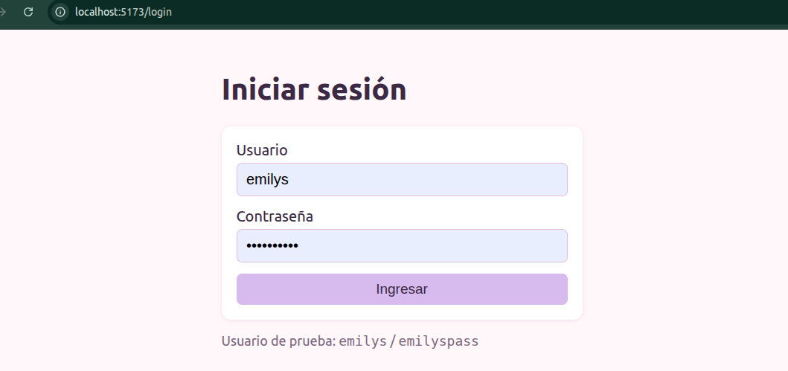
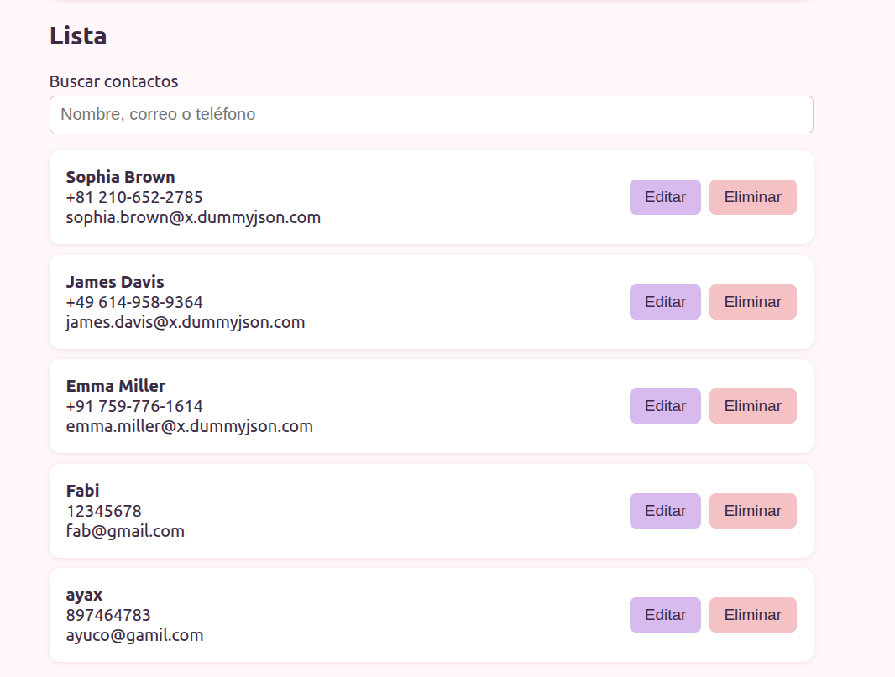
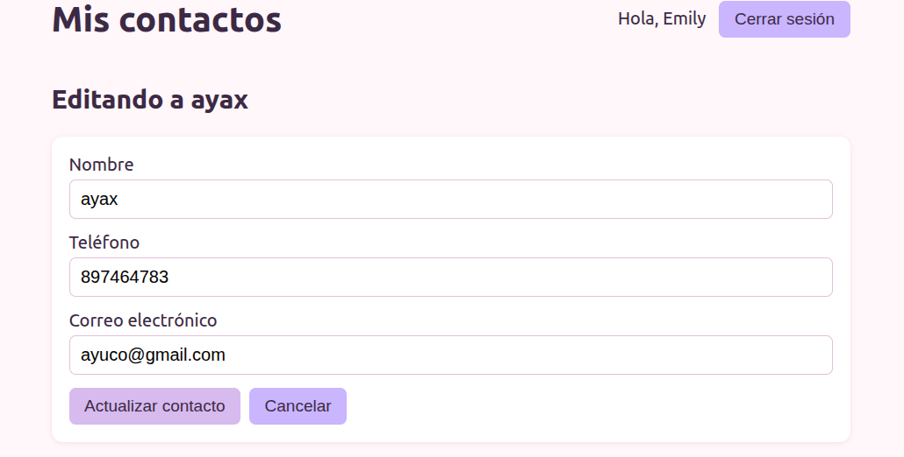
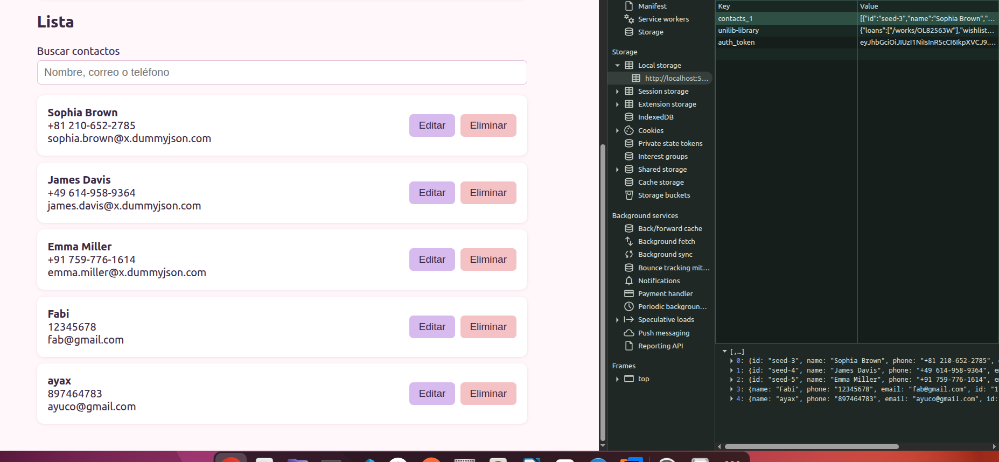
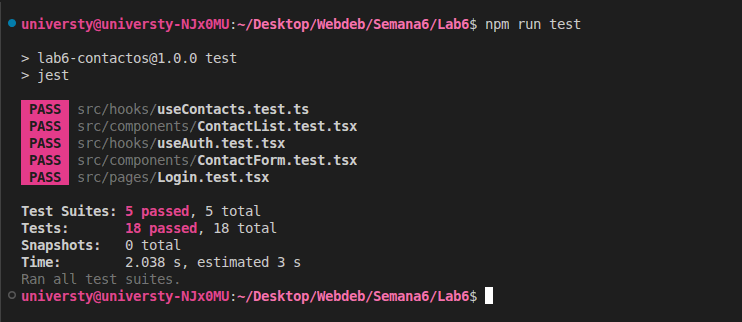

# App de Contactos (React + TSX)

Semana 6 - Desarrollo Web 

## La idea

Es una app para guardar contactos: te logueas y despues podes agregar, ver, editar, eliminar y buscar contactos (nombre, telefono y correo). El login funciona con token: la app le pide el token a una API, lo guarda, lo manda en los headers y lo borra cuando cerras sesion.

Usuario de prueba: `emilys` / `emilyspass`

## Como lo fui pensando

Esta semana el lab pedia tres cosas: pruebas, login con token contra una API y deploy. 

- **services/auth.ts** - solo hace el fetch y maneja el token en `localStorage` (`getToken`, `saveToken`, `removeToken`). No sabe nada de React, igual que los services de las semanas anteriores. Para la API use **DummyJSON Auth**, la que paso el profe en clase: `POST /auth/login` devuelve el `accessToken` y `GET /auth/me` es una ruta protegida que pide el header `Authorization: Bearer <token>`, tal cual salia en las diapositivas.
- **context/AuthContext.tsx + hooks/useAuth.ts** - lo mismo que el ThemeContext de la semana 4: un Provider guarda `user`, `token`, `login` y `logout`, y cualquier componente lo usa con `useAuth()`. Cuando se abre la app, si ya hay un token guardado lo valida con `/auth/me`; si el servidor lo rechaza (401) lo borra y te manda al login.
- **components/ProtectedRoute.tsx** - si no hay token redirige a `/login` con `<Navigate>`. Mientras valida la sesion muestra "Cargando sesion...".
- **services/contacts.ts + hooks/useContacts.ts** - el hook personalizado que pedia el lab. DummyJSON no tiene un CRUD de contactos que guarde de verdad (sus add/update/delete son simulados), asi que la primera vez que entra un usuario se cargan 5 contactos de `GET /users` (mandando el Bearer token) y despues agregar/editar/eliminar se guarda en `localStorage` por usuario. Asi el CRUD se ve real incluso en el deploy.
- **components/ContactForm.tsx** - formulario controlado (como el NameForm de la semana 3) con validaciones: nombre obligatorio, telefono valido y correo valido. Sirve para agregar y tambien para editar.
- **components/ContactList.tsx** - muestra la lista con buscador (filtra con `useMemo`) y botones de editar y eliminar. Lo meti en `React.memo` por lo que vimos en la semana 5.
- **pages/Login.tsx y pages/ContactsPage.tsx** - las dos pantallas. `App.tsx` solo define las rutas con React Router.
- **apiConfig.ts** - la URL de la API sale de la variable de entorno `VITE_API_BASE_URL` (si no existe usa `https://dummyjson.com`), asi no queda escrita en el codigo y se puede configurar en Vercel.

## Pruebas

Use **Jest + React Testing Library** como pedia el lab. La idea que segui: probar lo que el usuario ve y hace (`getByRole`, `getByLabelText`, `userEvent`) y no el estado interno. El `fetch` se simula con `jest.fn()` para no pegarle a la API de verdad (esta en `src/test/helpers.ts`).

| Archivo | Que prueba |
|---|---|
| `pages/Login.test.tsx` | se ve el formulario; con datos correctos guarda el token y redirige; con datos malos muestra el error y no guarda nada |
| `components/ContactList.test.tsx` | muestra los datos, mensaje cuando esta vacia, buscador, boton editar y boton eliminar |
| `components/ContactForm.test.tsx` | errores de validacion sin enviar, envio correcto (y se limpia), modo edicion y cancelar |
| `hooks/useContacts.test.ts` | **hook personalizado**: carga desde la API con el header `Authorization: Bearer`, usa `localStorage` sin pedir a la API, agregar/editar/eliminar y error si falla |
| `hooks/useAuth.test.tsx` | login guarda el token, logout lo borra, restaura la sesion con `/auth/me` y borra el token si da 401 |

Son 5 archivos y 18 pruebas (los 3 componentes y 1 hook que pedia el lab, mas `useAuth` de extra).

Un detalle: Jest no entiende `import.meta.env` (que usa Vite), asi que en `jest.config.cjs` cambio `apiConfig` por un archivo falso (`src/test/apiConfigMock.ts`) solo para los tests.

## Sobre el token

Guarde el token en `localStorage` porque es lo que se vio en clase y es lo mas simple para este lab. Se que no es lo mas seguro (si hubiera un ataque XSS podrian leerlo). En las diapositivas mencionan algo mejor como cookies seguras HttpOnly, pero eso necesita un backend propio que las configure.

## Despliegue

Lo desplegue en Vercel conectando el repo de GitHub:

- Root Directory: `Lab6`
- Build Command: `npm run build`
- Output Directory: `dist`
- Variable de entorno: `VITE_API_BASE_URL=https://dummyjson.com`
- `vercel.json` manda todas las rutas a `index.html` (porque es una SPA con React Router y sino al refrescar da 404).

## Capturas

!

